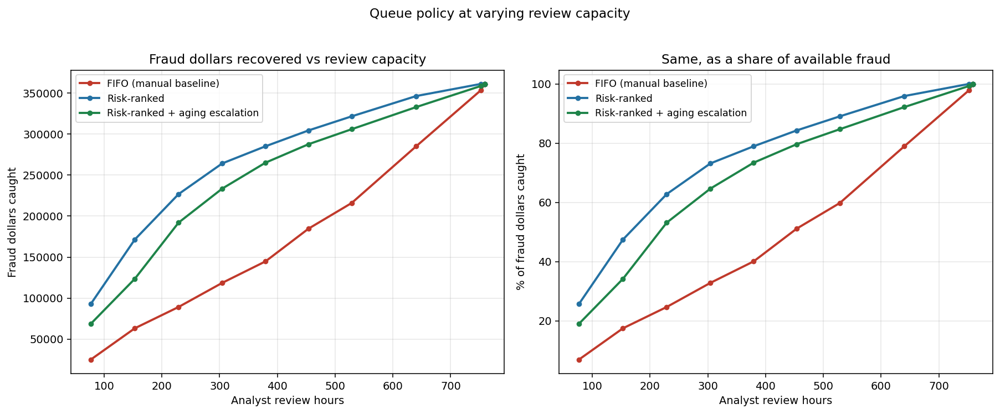
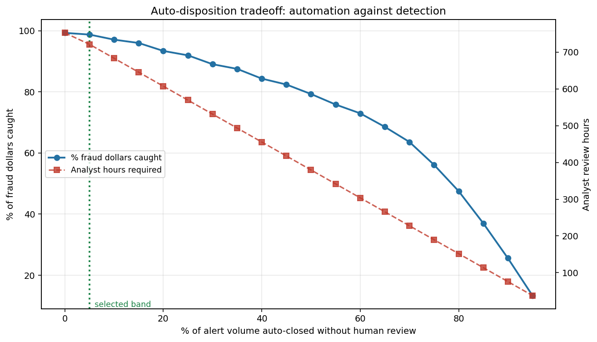

# alert-triage-sim

**Alert triage and review queue prioritization system**

A detection threshold tells you how many alerts you will get. It does not tell
you what happens to them. A real review operation has finite analyst capacity,
a queue that does not clear, and a service-level commitment — and under those
constraints *which alert you review first* decides how much fraud you actually
catch and how long it sits undetected.

This project simulates that queue. It consumes the scored alert stream produced
by [`fraud-threshold-lab`](https://github.com/aizaguirre3/fraud-threshold-lab), runs it through competing
prioritization policies at a fixed analyst headcount, and measures what each
one is worth in fraud dollars, detection latency, and SLA breaches.

**Headline result:** at the staffing level where FIFO catches 40.1% of fraud
dollars, risk-ranked review reaches the same capture with **67% less analyst
capacity** — 127 hours instead of 379 over a 30-day window.

Every number below comes from a single reproducible run. The results that
undercut the argument are here too, and there are several.

---

## What the pipeline does, in order

1. **Load the alert stream** — 88,581 scored transactions with amounts,
   outcomes, and per-alert TreeSHAP attributions, exported by P1.
2. **Apply the detection threshold** — P1's cost-optimal 0.0248, giving 11,384
   alerts over 30.8 days.
3. **Simulate three policies** at a fixed capacity of 3 analysts × 8h × 7 days.
4. **Sweep capacity** from 10% to 150% of that baseline for each policy.
5. **Sweep the auto-disposition band** — how much can close without review.
6. **Track SLA aging** and report breach rates per policy.
7. **Serve a reviewer interface** showing each alert's score *and why*.

Single command: `make all`. Runtime **1.1 seconds** for the full simulation,
capacity sweep, and auto-disposition sweep (`runtime_seconds` in
`artifacts/tables/run_results.json`).

---

## The setup

| | |
|---|---|
| Scored transactions | 88,581 |
| Detection threshold | 0.0248 (P1's cost-optimal point) |
| Alerts | 11,384 (12.9% of transactions) |
| Of which fraud | 2,369 (**20.8% precision** — 4 in 5 alerts are false alarms) |
| Fraud value in queue | $361,351 |
| Window | 30.8 days |
| Analyst capacity | 3 analysts × 8h × 7 days = 360 reviews/day |
| **Capacity vs demand** | **739h supply vs 759h demand — 97%** |

That 97% matters for reading everything below. The operation is *almost*
keeping up, which is the realistic and the least flattering case for
prioritization: when you can review nearly everything, the order barely changes
what you catch. The interesting differences show up in *latency* at full
capacity, and in *capture* once capacity is constrained.

Two hour figures recur below and they measure different things. **739h** is
review *supply* over the 30.8-day arrival window: 360 reviews a day at 4
minutes each. **752h** is review work *completed*: 11,281 reviews at 4 minutes
each, including the 24-hour drain past the last arrival during which the
operation keeps working the queue (see Design decisions). Completed work can
exceed in-window supply only because of that drain.

## Policies

- **FIFO** — first in, first out. The manual baseline.
- **Risk-ranked** — highest score first.
- **Risk-ranked + aging escalation** — highest score first, but a reserved
  third of capacity always goes to the longest-waiting alert.

---

## Results

### At full capacity (739 analyst hours)

| | FIFO | Risk-ranked | Risk-ranked + aging |
|---|---|---|---|
| Alerts reviewed | 11,281 (99.1%) | 11,281 | 11,281 |
| Fraud caught | 2,339 (98.7%) | **2,368 (100.0%)** | 2,360 (99.6%) |
| Fraud dollars caught | $353,473 (97.8%) | **$361,292 (100.0%)** | $358,764 (99.3%) |
| **Median time to detection** | 31.5h | **9.8h** | 10.8h |
| p90 time to detection | 39.0h | **16.5h** | 23.2h |
| **Worst wait, any alert** | **47.7h** | 741.9h | 91.8h |
| SLA breach rate (24h) | 60.7% | **10.3%** | 35.9% |

**At near-parity capacity, prioritization is a latency story, not a capture
story.** All three policies review the same number of alerts (11,281) and FIFO still catches
97.8% of fraud dollars. What changes is speed: risk ranking cuts median time to
detection from 31.5 hours to 9.8, a **3.2x improvement**, and drops SLA breaches
from 60.7% to 10.3%.

Anyone claiming prioritization is worth a large capture gain at full staffing is
overselling it. Its value at full staffing is that fraud is found within a
shift instead of a day and a half.

### The finding that changed the design: SLA breach rate is the wrong metric alone

Aging escalation posts a **worse** SLA breach rate than pure risk ranking —
35.9% against 10.3%. Taken at face value that says the policy built to protect
the SLA damages it. The distribution says otherwise:

| | p90 wait | p99 wait | **max wait** |
|---|---|---|---|
| Risk-ranked | 16.5h | 449.5h | **741.9h (31 days)** |
| Risk-ranked + aging | 23.2h | 86.7h | **91.8h (3.8 days)** |

Pure risk ranking keeps most alerts fast and **abandons a tail for a month**.
Those alerts are low-scoring and almost all legitimate, so a fraud-only view of
latency cannot see the problem at all. Aging trades a higher count of small
breaches for an **8x reduction in the worst case**.

A binary "did it breach 24 hours" metric cannot tell those apart — breaching by
one hour and breaching by thirty days score identically. The operational choice
between them is a real one, and it needs the distribution, not the rate.

This also drove a design change. An escalation tier that gets *all* spare
capacity degenerates into FIFO on a backlogged queue, because every alert ages
past the escalation point before anyone reaches it. Measured on the synthetic
stream, an unshared tier reproduced FIFO's output exactly. Reserving a fixed
third fixes it, and there is a test asserting both endpoints: share 0 reproduces
pure risk ranking, share 1 reproduces FIFO. The reserved credit is also
use-it-or-lose-it: it cannot bank while nothing has aged, so a quiet first day
cannot be followed by a long burst of escalated picks. A test asserts the tier
never takes two consecutive reviews at the one-third share.

### Capacity sweep — where prioritization actually pays

Percentage of fraud **dollars** caught, by policy and staffing level:

| Capacity | Analyst hours | FIFO | Risk-ranked | Aging |
|---|---|---|---|---|
| 10% | 77h | 6.7% | **25.6%** | 19.0% |
| 20% | 153h | 17.3% | **47.2%** | 34.2% |
| 30% | 229h | 24.7% | **62.7%** | 53.2% |
| 50% | 379h | 40.1% | **78.9%** | 73.4% |
| 70% | 529h | 59.8% | **89.0%** | 84.5% |
| 85% | 640h | 78.9% | **96.1%** | 92.4% |
| 100% | 752h | 97.8% | **100.0%** | 99.3% |

**This is the automation argument.** At half staffing, risk ranking catches
78.9% of fraud value against FIFO's 40.1% — nearly double, from the same
analysts reviewing the same number of alerts in a different order.

Stated as equivalent capacity — what staffing risk-ranked review needs to match
what FIFO achieves:

| FIFO at | FIFO capture | Risk-ranked needs | Hours saved | Capacity cut |
|---|---|---|---|---|
| 30% (229h) | 24.7% | ≤77h | ≥152h | **≥67%** |
| 50% (379h) | 40.1% | 127h | 252h | **67%** |
| 70% (529h) | 59.8% | 214h | 315h | **60%** |
| 85% (640h) | 78.9% | 380h | 261h | **41%** |
| 100% (752h) | 97.8% | 693h | 59h | **8%** |

The 30% row is a bound, not a crossover. The sweep's floor is 10% capacity
(77h), and risk-ranked review already catches 25.6% of fraud dollars there,
above the 24.7% target, so the true equivalent sits somewhere below 77h.

The saving shrinks as staffing rises, and that is the honest shape of it. A
fully staffed operation gains 8%. A stretched one gains two thirds. Prioritizing
a queue is worth most exactly when you cannot afford to work all of it — which
is the situation automation is meant to address.



### Auto-disposition

Closing low-risk alerts without human review, denominators held against the
**full** stream so auto-closed fraud counts as missed:

| Auto-closed | Alerts | Analyst hours | Hours saved | Fraud $ caught | SLA breach |
|---|---|---|---|---|---|
| 0% | 0 | 752h | — | 99.3% | 35.9% |
| 5% | 570 | 721h | 31h | 98.7% | 12.2% |
| **10%** | **1,139** | **683h** | **69h** | **97.1%** | **3.5%** |
| 15% | 1,708 | 645h | 107h | 96.0% | 1.1% |
| 20% | 2,277 | 607h | 145h | 93.4% | 0.3% |
| 30% | 3,415 | 531h | 221h | 89.0% | 0.0% |
| 50% | 5,692 | 379h | 373h | 79.3% | 0.0% |

Under a 2% capture-loss tolerance the selected band closes 5% of alerts and
saves 31 hours. The more interesting row is 10%: giving up **2.2 points** of
fraud capture buys back 69 analyst hours *and* collapses the SLA breach rate
from 35.9% to 3.5%.

That second effect is the one arithmetic alone misses. Auto-closing does not
only remove work — it frees capacity for everything else in the queue, so the
alerts that remain get seen far sooner. The curve is computed under simulation
rather than by subtraction precisely to capture it.



### Reviewer interface

A Streamlit queue view built against one requirement: **a reviewer should
understand why an alert scored high without leaving the screen.**

- Queue ordered by SLA breach first, then risk score
- Per-alert detail leading with the top five TreeSHAP contributors, each with
  its value and whether it raised or lowered risk
- SLA countdown per alert, with breaches called out
- Confirm / clear / escalate actions appended to a disposition log

Attributions are exact TreeSHAP values from LightGBM's `pred_contrib`, computed
in P1 and carried in the alert stream, so the interface needs no model at
runtime and no `shap` dependency.

```bash
make app
```

---

## Design decisions

**Capacity is a rate, not a set of analyst agents.** Every question here depends
on how many reviews per hour the operation absorbs and when, and a rate captures
that without inventing per-analyst behaviour the data cannot support.

**The simulation drains past the last arrival.** Review capacity continues for
one SLA period after the final alert. Without it, an alert arriving near the end
of the window can never be reviewed however it scores, and the SLA breach metric
becomes an artifact of where the window happens to stop. This was found by a
test: a burst-arrival stream whose arrivals all fell outside a shift window
generated *zero* review slots and silently reviewed nothing.

**The escalated tier gets a reserved share of capacity.** Otherwise aging
collapses into FIFO — see above.

**All policies review the same number of alerts.** Policy changes *which*
alerts, never *how many*; there is a test enforcing it, because any difference
would confound every comparison built on top.

**Auto-closed fraud counts against capture.** A band that discards the alerts it
fails on would otherwise flatter itself.

---

## Limitations

1. **Review is assumed perfect.** Reviewing an alert reveals its true label.
   Real analysts miss fraud and clear it wrongly, at rates that vary by case
   complexity and probably correlate with the score. Modelling that would mean
   layering a second invented error model on an already-assumed cost model; the
   policy comparison is cleaner without it, but every capture number here is an
   upper bound.

2. **Handling time is a constant 4 minutes.** No variation by case complexity,
   no correlation with score, no fatigue, no context-switching cost. A
   high-scoring alert with a complex profile plausibly takes longer than a
   borderline one, which would erode some of prioritization's advantage.

3. **Capacity is perfectly fungible within a shift.** No individual analysts, no
   specialisation, no handoffs, no breaks. Three analysts are 45 reviews an
   hour, whoever they are.

4. **One 30-day window, one alert stream.** No seasonality, no fraud-pattern
   drift, no repeated runs, no confidence intervals. A different month would
   give different dollar figures.

5. **The scores inherit every limitation of P1**, including that IEEE-CIS labels
   are chargeback-reported rather than confirmed fraud, so some positives are
   inferred and undetected fraud sits in the negative class.

6. **Arrival times are transaction times.** A real alert arrives after scoring
   and routing latency, which would shift every wait upward by a roughly
   constant offset.

7. **The 97% capacity ratio is a choice, not a measurement.** It was set by
   picking 3 analysts against P1's cost-optimal alert volume. The capacity sweep
   exists because that single point is not the interesting output.

8. **Not a production system.** No real queue, no ticketing integration, no
   auth on the reviewer interface, no persistence beyond a CSV log.

---

## Reproducing

Requires Python 3.11+. The alert stream comes from a local `fraud-threshold-lab`
checkout that has been run once; `make data` copies it across. Without it,
`make synthetic` generates a stand-in stream with the same schema.

```bash
make all
```

Individual steps:

```bash
make data       # copy the exported alert stream from ../fraud-threshold-lab
make synthetic  # or: generate a synthetic stand-in stream
make run        # full simulation -> artifacts/
make app        # launch the Streamlit reviewer interface
make test       # 63 tests
```

Outputs land in `artifacts/tables/` (CSV plus `run_results.json` holding every
number in this README) and `artifacts/figures/`.

### Testing

63 tests on Python 3.11 and 3.12 in CI, using synthetic fixtures only — the
Kaggle-derived stream is not redistributable and none of the queue logic needs
it. The tests concentrate on what a reviewer would question:

- review sequences worked out by hand for each policy on a six-alert fixture
- no alert reviewed before it arrives, or more than once, under lazy deletion
- all policies reviewing identical alert counts
- the escalation share reproducing pure risk ranking at 0 and FIFO at 1, and
  moving monotonically between them
- escalation credit never banking while the tier is empty, so the aging tier
  never takes two consecutive picks at the one-third share
- prioritization beating FIFO under constraint **and** making no difference when
  capacity is ample — the guard against overselling it
- auto-closed fraud counting against capture
- capacity equivalence saving nothing when a policy is compared against itself
- the reviewer interface's helpers (signal attribution table, disposition log),
  imported without Streamlit

---

## Project layout

```
src/triage/
  config.py           capacity, shifts, SLA, cost assumptions
  simulator.py        discrete-event queue, three policies
  metrics.py          outcomes, capacity sweep, policy equivalence
  autodisposition.py  auto-close band and tradeoff curve
  data.py             stream loading + synthetic generator
  review_helpers.py   reviewer-interface helpers, importable without Streamlit
  plots.py            figures
app/reviewer.py       Streamlit reviewer interface
scripts/              run_simulation.py, fetch_stream.py
tests/                63 tests, synthetic fixtures only
```

## Upstream

Alert stream and TreeSHAP attributions come from
[`fraud-threshold-lab`](https://github.com/aizaguirre3/fraud-threshold-lab), which scores IEEE-CIS
transactions with a time-aware split and selects the operating threshold by
expected cost. The threshold used here (0.0248) is that project's cost-optimal
point.
